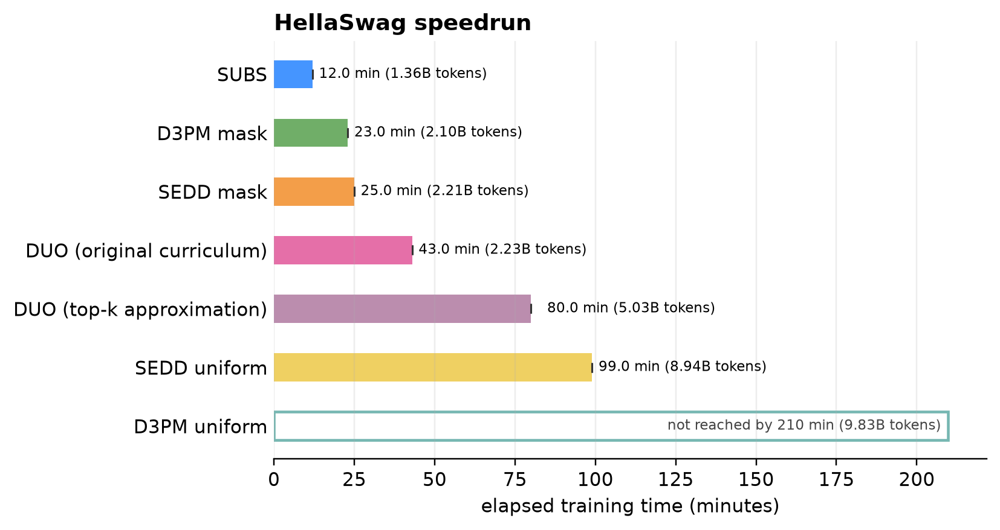
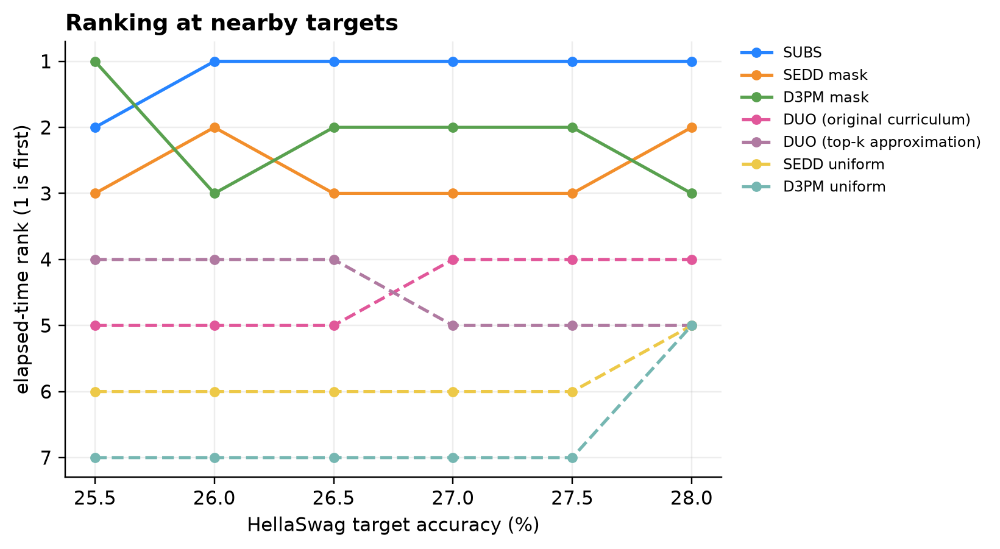
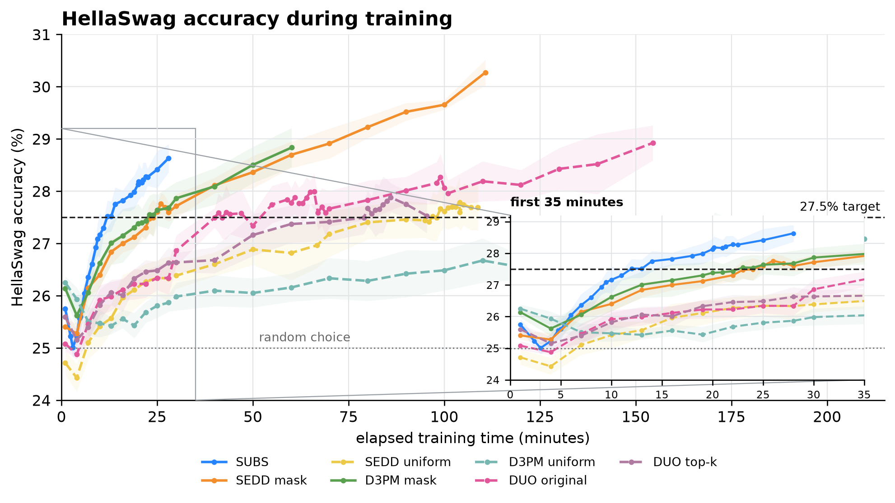

# speedrun-dlm: A speedrun benchmark for diffusion language models

**Train a diffusion language model (DLM) as fast as possible to reach a HellaSwag target.**

This repository asks how quickly one can train a diffusion language model on
*FineWeb*, using *8 GH200 GPUs*, until its average HellaSwag accuracy reaches **27.5%**.

**The leaderboard reports the average checkpoint time when HellaSwag accuracy across ten independent trainings reaches the target.**

The project is inspired by Keller Jordan and collaborators' **[modded-nanogpt](https://github.com/KellerJordan/modded-nanogpt) speedrun** and adapts it to diffusion language models, for which many core design choices are still open.

We fix a small DDiT backbone (170M parameters) and include re-implementations of **7 common single-block diffusion recipes** in `speedrun_dlm/train_dlm.py`.

> Note. Original methods and ideas belong to their respective authors. This is an independent project and is not affiliated with modded-nanogpt, its contributors, or the authors of the papers we cite.

## Contents

- [Leaderboard](#leaderboard)
- [Rules](#rules)
- [Model](#model)
- [HellaSwag target](#hellaswag-target)
- [How to submit](#how-to-submit)
- [Run](#run)
- [Check a candidate](#check-a-candidate)
- [Appendix](APPENDIX.md)
- [Accompanying paper](https://openreview.net/forum?id=WLNBGbEQnV)
- [Acknowledgements](#acknowledgements)

## Leaderboard

**Runs are ranked by training time to reach the HellaSwag target.**

To appear on the leaderboard, a DLM training recipe must reach **27.5% average accuracy** over ten independent trainings. Small tuning changes, new objectives, and architectural changes at the fixed model scale are all welcome.

| Rank by train time | Entry | Mean train time | Mean training tokens | Record |
| ---: | --- | ---: | ---: | --- |
| 1 | SUBS | 12.0 min | 1.36B | [0001](records/0001-subs-mask/) |
| 2 | D3PM mask | 23.0 min | 2.10B | [0002](records/0002-d3pm-mask/) |
| 3 | SEDD mask | 25.0 min | 2.21B | [0003](records/0003-sedd-mask/) |
| 4 | DUO, original curriculum | 43.0 min | 2.23B | [0004](records/0004-duo-simple/) |
| 5 | DUO, top-k approximation | 80.0 min | 5.03B | [0005](records/0005-duo-efficient/) |
| 6 | SEDD uniform | 99.0 min | 8.94B | [0006](records/0006-sedd-uniform/) |
| — | D3PM uniform | not reached by 209.7 min | 9.83B | [0007](records/0007-d3pm-uniform/) |

Each record contains per-training times, scores, checkpoint hashes, evaluation settings, and commands. The [measurement table](figures/checkpoint-evaluations.csv) contains all evaluated positions, and [records.csv](records/records.csv) collects the results above.

All six finishers have one-minute failing/passing/passing checks with 128 corruptions per answer. These checks use average accuracy over all ten trainings; the reported time is not an average of ten individual crossing times. See the [crossing checks](figures/crossing-confirmations.csv) and [evaluation details](APPENDIX.md).

Our [accompanying paper](https://openreview.net/forum?id=WLNBGbEQnV) explains how we chose HellaSwag by studying the stability of recipe rankings, improvement during training, and agreement with autoregressive reference rankings.



SUBS is first at targets from 26.0% to 28.0%. At 25.5%, D3PM mask is first.
The three masked recipes occupy the first three places from 26.5% onward,
with D3PM mask and SEDD mask both reaching the measured 28.0% crossing at about 40 minutes. Only the 27.5% target receives adjacent-minute confirmation; nearby-target rankings use the measured checkpoint grid.





## Rules

- Same *data*: pinned FineWeb GPT-2-tokenized data.
- Same *hardware*: two nodes with 4 GH200 GPUs each.
- Same *model scale*: the DDiT backbone described below.
- Same *number of trainings*: ten independent runs, using seeds 1–10 for the records above.
- Same *HellaSwag evaluation*: all 10,042 examples in the public validation split, with the prompt convention from the pinned Language Model Evaluation Harness.
- The *target* is 27.5% accuracy averaged across the ten trainings. Each training contributes equally.
- Runs are ranked by mean elapsed optimizer-step training time. Compilation, evaluation, and checkpoint writing are outside the clock.

While architectural modifications are acceptable, the DDiT backbone parameter count should remain comparable.

## Model

The benchmark fixes a small DDiT backbone at roughly nanoGPT-2 scale:

- 12 layers,
- width 768,
- 12 heads,
- context length 1024,
- GPT-2 tokenizer.

The diffusion-specific changes are:

- non-causal attention,
- denoising-time conditioning through adaptive layer norm, where used by the recipe,
- untied input embedding and output head.

## HellaSwag target

**DLMs are not easy to compare** because their full-sequence probabilities are expensive to estimate, and their training losses are not directly comparable across recipes.

This benchmark instead asks each trained model to choose the correct continuation from four possible answers on HellaSwag, without finetuning. The prompt stays unchanged, parts of each answer are corrupted, and the model scores how well it can recover the answer. We average over several corruptions and choose the answer with the lowest score per character. Random choice gives 25%; the target is 27.5%.

The code compares the four answer scores within each model. It does not compare the raw losses of different recipes. See [`evaluate_hellaswag.py`](speedrun_dlm/evaluate_hellaswag.py), [`finish_line_rule.json`](finish_line_rule.json), and the [appendix](APPENDIX.md) for the evaluation details.

## How to submit

To get your method on the leaderboard, **open a pull request** with:

- a new folder under `records/`,
- a new row in [`records/records.csv`](records/records.csv),
- any code needed to run the method.

Include the ten training results, evaluation outputs, training commands, and checkpoint hashes, following the existing records. [`records/make_record.py`](records/make_record.py) builds the result files from a per-training measurement table:

```bash
python records/make_record.py \
  --entry subs_mask --position minute:012 \
  --measurements figures/checkpoint-evaluations.csv \
  --record-dir results/rebuilt-subs-record
```

Each submitted record must satisfy the [rules](#rules) above. We will check the timing and evaluation artifacts before updating the leaderboard.

## Run

```bash
python3 -m venv .venv
source .venv/bin/activate
pip install -c constraints.txt -r requirements.txt

bash prepare_data.sh 9830400001
python data/prepare_training_prefix.py \
  --shards data/fineweb10B/fineweb_train_*.bin \
  --target-tokens 9830400000 --output-shards 6 \
  --output-dir data/training-prefix --name-prefix fineweb_train \
  --manifest data/training-prefix/manifest.json
python -m speedrun_dlm.prepare_hellaswag data/hellaswag-validation.jsonl.gz

python records/reproduce.py records/0001-subs-mask \
  --seed 1 --output results/subs/seed1 --execute
```

The data are prepared once and reused for every model. The prefix preparation keeps the ordered token stream the same across different batch sizes. Repeat for seeds 1–10 and use the other record folders for their training configurations.

The command above uses eight GPUs on one node. For the recorded two-node setup, set `NNODES=2`, `NPROC_PER_NODE=4`, `MASTER_ADDR` to the first node, and `NODE_RANK=0` or `1`, then run the command on both nodes. Without `--execute`, it prints the complete command for inspection.

## Check a candidate

```bash
python -m speedrun_dlm.evaluate_hellaswag path/to/checkpoint.pt \
  --data data/hellaswag-validation.jsonl.gz \
  --output results/hellaswag \
  --mc-samples 128 --prefixes 32,128 \
  --sampling-scheme randomized_lattice --seed 314159 \
  --duo-keep-prob-table data/duo-gpt2.pkl
```

This command records the scores and per-example outcomes for one checkpoint. Repeat for the ten trainings, then average their accuracies. The data file can be anywhere: pass its path with `--data`.

## Appendix

**More details on evaluation, timing, and recorded results are in [the appendix](APPENDIX.md).**

## Acknowledgements

This repo builds on a lot of useful public work. In particular, we used:

- [modded-nanogpt](https://github.com/KellerJordan/modded-nanogpt) for the speedrun setup,
- [MDLM](https://github.com/kuleshov-group/mdlm), [SEDD](https://github.com/louaaron/Score-Entropy-Discrete-Diffusion), [D3PM](https://github.com/google-research/google-research/tree/master/d3pm), and [DUO](https://github.com/s-sahoo/duo) for the different DLM objectives,
- [FineWeb](https://huggingface.co/datasets/HuggingFaceFW/fineweb), [fineweb10B-gpt2](https://huggingface.co/datasets/kjj0/fineweb10B-gpt2), [HellaSwag](https://huggingface.co/datasets/Rowan/hellaswag), and the [Language Model Evaluation Harness](https://github.com/EleutherAI/lm-evaluation-harness) for the data and evaluation convention.
